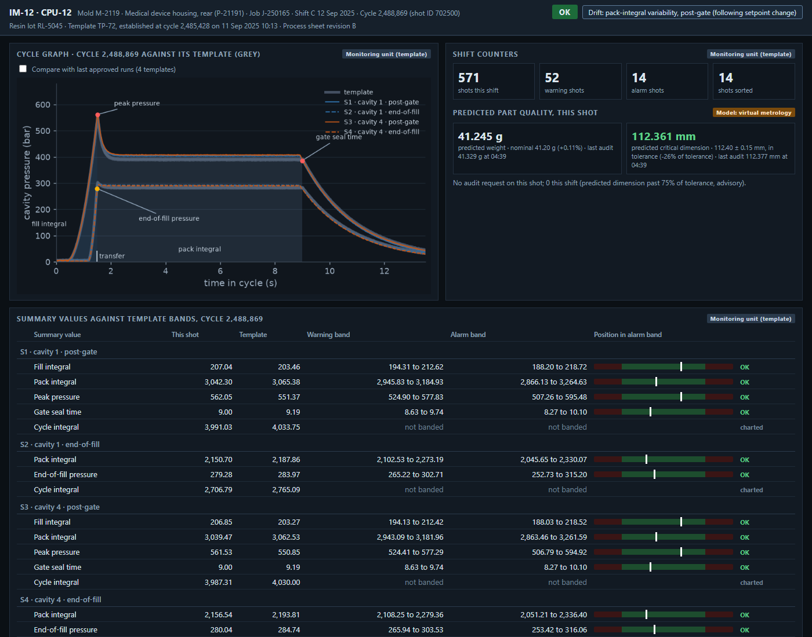

# spc-quality-ml

SPC and quality analytics for two shops. At an injection molder, every shot from an instrumented cell is retained, charted, measured and screened. At a progressive-die metal stamper, every chart in use is assessed, then redesigned with per-stroke tonnage monitoring, and the results are measured.

## Injection molding: cavity pressure monitoring and predictive quality

A data platform, an SPC layer and three model components for an injection molder's instrumented cell of two presses and six molds with cavity pressure sensors. The work joins every shot to its job, resin lot, setpoints and audits, runs the shop's control-chart rules on every shot, adds drift detection, puts a predicted weight and dimension on every shot and screens for shots unlike anything validated, and measures what each layer detects against how often it flags good parts. It delivers the monitoring unit screen and shift chart, run reports at job close, a quality dashboard, an ML overview, an ML technical report and an MLOps monitoring report.

Read the [case README](molding_predictive_quality/README.md) and the [deliverables index](https://brimsystems.github.io/spc-quality-ml/molding_predictive_quality/docs/index.html).

## Metal stamping: SPC program

Statistical process control as it runs at a progressive-die metal stamper with eleven presses, in two documents from the quality engineer's working set:
- the control chart design revalidation, which derives each class's chart from its variance structure (three-way charts with coil-change centring on formed characteristics, tool-wear charts on hole diameters, X-bar and R on hole position and flatness), sets out limits governance across sharpenings, and measures false-alarm rates and detection by ARL against the design, including the per-stroke EWMA on press tonnage;
- the SPC quarterly review for April to June 2026: signals against expectation and their dispositions, capability with intervals by the right index for each chart, measurement gating, sharpenings, per-stroke stops and first-piece approvals.

The plant at summary level and one part family in full, with the PR-03 SPC terminal and press monitor screens at the moment of a per-stroke stop.

Read the [case README](stamping_spc_program/README.md) and the [deliverables index](https://brimsystems.github.io/spc-quality-ml/stamping_spc_program/docs/index.html).

## Author

Brian Davis. Data engineering and applied analytics/ML for manufacturers. Other work: [github.com/brimsystems](https://github.com/brimsystems?tab=repositories).
