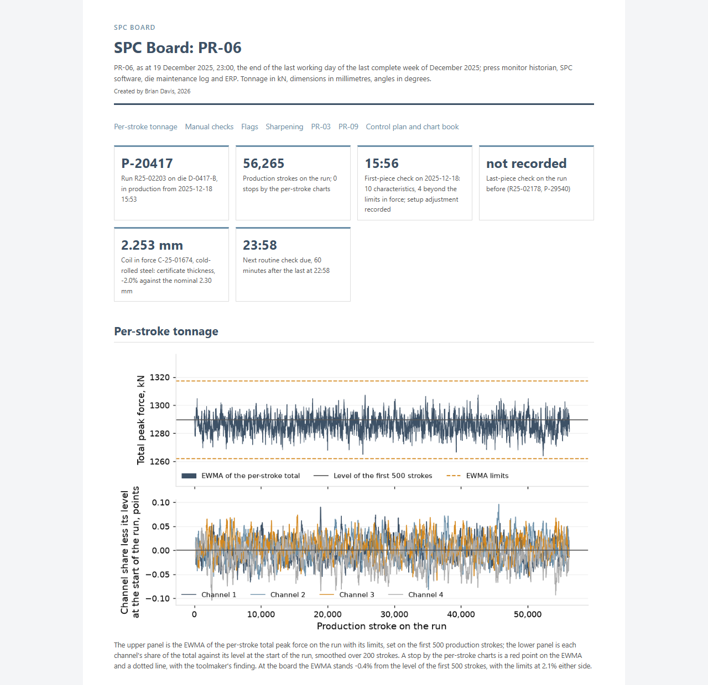

# mfg-spc-program

Statistical process control at a progressive-die metal stamper, January 2023 to December 2025: an assessment of every chart in use on the shop's own record, a redesign of the charts, limits, sampling and reaction plan on three pilot presses with per-stroke tonnage monitoring, and the results against the same months of 2024 and 2023 with the other presses as the comparison. Nine analyses feed two reports, a control plan and chart book, three SPC boards and a plant quality dashboard, all computed from the shop's exported records by one pipeline.

[](https://brimsystems.github.io/spc-quality-ml/stamping_spc_program/docs/spc_board/pr_06.html)

## What is included

- Two reports: the [SPC Assessment](https://brimsystems.github.io/spc-quality-ml/stamping_spc_program/docs/reports/spc_assessment.html) and the [SPC Redesign and Results](https://brimsystems.github.io/spc-quality-ml/stamping_spc_program/docs/reports/spc_redesign_and_results.html), each with findings, exhibits, actions and an appendix of the tables behind every finding.
- The [control plan and chart book](https://brimsystems.github.io/spc-quality-ml/stamping_spc_program/docs/control_plan/control_plan_and_chart_book.html): what is in force at 31 December 2025 on the 30 parts that run on the pilot presses, three in full.
- Three SPC boards, one per pilot press: [PR-03](https://brimsystems.github.io/spc-quality-ml/stamping_spc_program/docs/spc_board/pr_03.html), [PR-06](https://brimsystems.github.io/spc-quality-ml/stamping_spc_program/docs/spc_board/pr_06.html), [PR-09](https://brimsystems.github.io/spc-quality-ml/stamping_spc_program/docs/spc_board/pr_09.html).
- The [plant quality dashboard](https://brimsystems.github.io/spc-quality-ml/stamping_spc_program/docs/dashboard/index.html), December 2025 as the current month. Index of deliverables: [docs/index.html](https://brimsystems.github.io/spc-quality-ml/stamping_spc_program/docs/index.html).
- The pipeline from the exported files to the marts: dlt, DuckDB and dbt with schema tests, and one build command that writes every table, figure and page.

## Business Context

The shop is a progressive-die metal stamper: about 110 employees, IATF 16949 certified, one plant, eleven presses, about 180 part numbers on about 170 dies for automotive, appliance, HVAC, industrial, electrical and consumer customers. It charted six to twelve characteristics a part at the press, in SPC software on the seven medium presses and on paper on the four high-speed presses, filed a Ppk from 300 consecutive pieces at PPAP, sharpened dies on a stated shot interval, and adjusted the die at the operator's discretion. The assessment of that record as it stood at 31 December 2024 found that the software's rolling limits flagged 18.5% of what fixed limits flag, that the printed limits on the paper presses signalled on 22.5% of subgroups, that production Ppk on critical formed characteristics was 1.03 against 1.85 filed, with 55% of the variance between coils, that two reworked check fixtures consumed 31.2% and 33.6% of tolerance, and that 54 of the 55 burr nonconformances of 2024 fell on runs that carried the die past its stated sharpening interval.

From 3 February 2025 the shop changed its practice on three pilot presses, PR-03, PR-06 and PR-09. It rebuilt and studied the two fixtures again, replaced the burr limit samples and qualified the operators, connected the gauges to the terminals, moved the paper press to the software, fixed limits from a stable baseline after each sharpening, charted formed characteristics on a three-way chart that carries coil-to-coil variation and hole diameters on a tool-wear chart, recorded a coil-change subgroup with a centring step, set check frequency from the parts between checks, put a written reaction plan on every chart and set the sharpening count from each die's burr. From 5 May 2025 the press monitor's historian kept every stroke on those presses and the per-stroke total and channel shares were charted, with the press stopping on a signal. From 2 September 2025 the same changes reached the other eight presses.

From March to December 2025 on the pilot presses, against the same months of 2024, customer PPM was 118 against 389 (and 198 in 2023, p = 0.45), scrap and rework 1.69% of revenue against 2.60%, production Ppk on critical formed characteristics 1.43 against 1.00, and alarm signals 4.4 per 100 subgroups against 15.1. The per-stroke charts stopped the press 112 times, all 70 punch replacements followed a stop, and sorting events were 5 against 7 (p = 0.77). On the comparison presses, where nothing changed from February to August, PPM was 382 against 328 and every measure moved within its 2024 interval.

## Analyses

| Analysis | Question | Finding | Report | PPAP element |
|---|---|---|---|---|
| Charts and limits | Do the limits in use signal when the process changes? | On 210 formed characteristics and hole diameters the software's rolling limits flagged 18.5% of the subgroups that fixed baseline limits flag; on the paper presses the printed limits signalled on 22.5% of subgroups with an action recorded on 28.0% of signals. | [SPC Assessment](https://brimsystems.github.io/spc-quality-ml/stamping_spc_program/docs/reports/spc_assessment.html) | 11, initial process studies |
| Subgrouping and capability | Does the Ppk filed at PPAP describe production? | On 84 critical formed characteristics the PPAP Ppk is 1.85 and the production Ppk 1.03 (0.98 to 1.10); 55% of the overall variance is between coils. | [SPC Assessment](https://brimsystems.github.io/spc-quality-ml/stamping_spc_program/docs/reports/spc_assessment.html) | 9 and 11, dimensional results and initial process studies |
| Risk window and sorting | How many parts pass between checks, and what does a sorting event cover? | Between routine checks 1,010 to 21,113 parts pass by part; 12 of the 15 sorting events of 2024 trace to a die event between two checks. | [SPC Assessment](https://brimsystems.github.io/spc-quality-ml/stamping_spc_program/docs/reports/spc_assessment.html) | IATF 16949 9.1.1.1 |
| Measurement systems | How much of the tolerance do the check fixtures and the burr check consume? | Two reworked check fixtures consumed 31.2% and 33.6% of tolerance against 8.9% and 8.4% at PPAP; the burr check agreed with the burr gauge on 80% of calls (kappa 0.44); keyed readings end in 0 or 5 at 1.75 times the uniform rate. | [SPC Assessment](https://brimsystems.github.io/spc-quality-ml/stamping_spc_program/docs/reports/spc_assessment.html) | 8, measurement system analysis studies |
| Adjustment | What follows a point near the limits? | 23.4% of points beyond two sigma carry a recorded adjustment; subgroup means on the characteristics adjusted at the press carry a within-coil autocorrelation of -0.15 against -0.07 on the others and 10.0% more variance. | [SPC Assessment](https://brimsystems.github.io/spc-quality-ml/stamping_spc_program/docs/reports/spc_assessment.html) | IATF 16949 9.1.1.1 |
| Die wear | Is the sharpening interval set by the die's burr? | On 41 of 124 dies the stated sharpening interval is longer than the shot count at which burr reaches 80% of its limit; sharpenings are logged a median 1.14 times the stated interval; 54 of the 55 burr nonconformances of 2024 fell on runs that carried the die past it. | [SPC Assessment](https://brimsystems.github.io/spc-quality-ml/stamping_spc_program/docs/reports/spc_assessment.html) | IATF 16949 9.1.1.1 |
| Recording | Are the planned checks recorded, and when? | 65.2% of routine checks are stamped within five minutes of the hour; the night shift records 84% of planned checks against 94% on days; 15.0% of keyed subgroups were entered more than 20 minutes after the parts. | [SPC Assessment](https://brimsystems.github.io/spc-quality-ml/stamping_spc_program/docs/reports/spc_assessment.html) | IATF 16949 9.1.1.1 |
| Per-stroke monitoring | What does charting every stroke find that the hourly check cannot? | The per-stroke charts stopped the pilot presses 112 times; the toolmaker found a worn or chipped punch on 70, slug pulling on 24 and nothing on 18 (0.88 per 1,000,000 strokes); all 70 punch replacements followed a stop and every one of the 13 punch breaks was stopped on the stroke of the break. | [SPC Redesign and Results](https://brimsystems.github.io/spc-quality-ml/stamping_spc_program/docs/reports/spc_redesign_and_results.html) | IATF 16949 9.1.1.1 |
| Outcomes | What moved on the pilot presses, against 2024, 2023 and the comparison presses? | On the pilot presses customer PPM fell from 389 to 118 (p = 0.0046; against 2023's 198, p = 0.45), scrap and rework from 2.60% to 1.69% of revenue, production Ppk on critical formed characteristics from 1.00 to 1.43, and alarm signals from 15.1 to 4.4 per 100 subgroups; sorting events fell from 7 to 5 (p = 0.77); the comparison presses moved within their 2024 intervals. | [SPC Redesign and Results](https://brimsystems.github.io/spc-quality-ml/stamping_spc_program/docs/reports/spc_redesign_and_results.html) | 11, initial process studies |

## Methods

Statistics: control charts and capability indices by AIAG SPC, 2nd edition, with within-subgroup sigma pooled across subgroups and overall sigma from all readings; stability by Western Electric rules 1 to 4; average run length by the Markov chain method; variance components by a nested random-effects model fitted by REML; gauge R&R by the AIAG MSA, 4th edition, ANOVA method with %tolerance at 6 sigma and ndc; attribute agreement with Fleiss' kappa; Anderson-Darling with the Box-Cox transformation on bounded characteristics; lag-1 autocorrelation of subgroup means within a run and coil; an EWMA for autocorrelated data on the per-stroke total and a residual chart on each channel's share; the exact Poisson rate test on event and complaint counts, a bootstrap interval over complaints on PPM, and the two-proportion score test with the Newcombe interval. Every result carries its interval, its sample size and its coverage.

Data engineering: the exported files are loaded to DuckDB with dlt, the per-stroke and per-minute press monitor exports are read in place as Parquet, and a dbt project builds 84 staging, intermediate and mart models with schema tests on every layer. Every table, figure and page is written by scripts that read the marts; no number is typed into a page, and two consecutive builds are byte-identical. Each report, the control plan, the boards and the dashboard has a table of every number it prints with the mart it is read from, under `analytics/reports/traces/`.

## Data

Thirty-six months of the shop's records, January 2023 to December 2025, export batch 20260106T053000Z-SPC36M: 658,446 subgroups on 1,560 characteristics, 6,710 production runs, 5,529 coils and 20,570,818 press strokes on the pilot presses from 5 May 2025.

Conditions of the record, each stated in the reports where it bears on a figure: keyed readings that prefer 0 and 5 (1.75 times the uniform rate) and readings that cannot be a measurement of the part (0.36% of keyed readings, set aside with the count stated), subgroups on a gauge out of service that day (4.3%) or past its calibration due date (3.5%), entries made after the parts (15.0% of keyed subgroups more than 20 minutes after), coil ids missing from subgroups and recovered from the run's coil sequence, complaints entered twice, sorting booked to the production run instead of the sorting labor code, shot counts rounded to the thousand in the die log, and paper charts transcribed for the assessment.

| Source | Tables | Records |
|---|---|---|
| SPC software | characteristics, control limits, subgroups, alarms, reaction plan steps | 730,033 |
| Press monitors | per-stroke peaks (pilot presses), per-minute summaries, tonnage windows, fault events | 20,816,301 |
| ERP | parts, dies, presses, production runs, coils, scrap, shipments | 20,322 |
| QMS | nonconformances, sorting events, complaints, dock audits, PPAP studies, scorecards | 9,906 |
| Die maintenance log | sharpenings, punch replacements, rebuilds, repairs | 2,369 |
| Calibration system | gauges, calibrations, gauge studies | 2,595 |
| Accounting | quality cost lines, contribution by part | 924 |
| Study worksheets | seven gauge R&R studies and two attribute agreement studies, as recorded | 9 |

Pipeline: `pipeline/load` loads each exported file to the `raw` schema; `pipeline/dbt` builds one staging model per source table, the intermediate models (the characteristic history with run, press, coil, die shot count, limits in force and gauge status joined; coil assignment; sharpening intervals; the trace of each sorting event to its die event and the check before) and the marts each analysis, the boards and the dashboard read. Every mart carries the export batch id.

## How to run

Python 3.12 or later. Run from `stamping_spc_program/`.

```bash
python -m venv .venv
```

Activate it: `.venv\Scripts\activate` on Windows, `source .venv/bin/activate` on Linux and macOS. Then:

```bash
pip install -e .
```

```bash
python -m pipeline.load.load_exports
```

```bash
cd pipeline/dbt && dbt build --profiles-dir . && cd ../..
```

```bash
python -m analytics.build_all
```

The last command writes every figure under `docs/figures`, the two reports, the control plan and chart book, the three boards, the dashboard, `docs/index.html`, this README and the number traces.

## Author

Brian Davis. Data engineering and applied analytics/ML for manufacturers. Other work: [github.com/brimsystems](https://github.com/brimsystems?tab=repositories).
