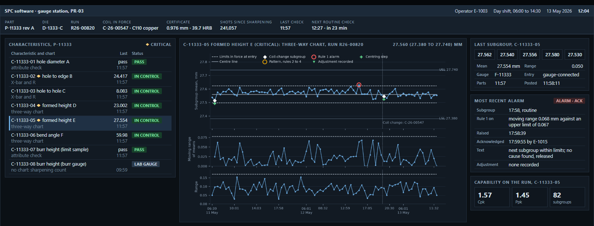

# SPC & Capability Study: Metal Stamping 

Statistical process control as it runs at a progressive-die metal stamper with eleven presses, on the shop's records from July 2025 to June 2026. 

- **[SPC Chart Design & Performance:](https://brimsystems.github.io/spc-quality-ml/stamping_spc_program/docs/reports/control_chart_design.html).** Comprehensive review of all active SPC charts. Includes overview of chart type selections, variance decompositions, measurement systems, and control limits. Statistical analyses review chart signals, special causes, and observed vs. expected performance. 
- **[Capability & SPC Review, Q2 2026:](https://brimsystems.github.io/spc-quality-ml/stamping_spc_program/docs/reports/spc_quarterly_review_2026_q2.html).** Quarterly review summarizing capability (Ppk/Ppu and Cpk/Cpu) across characteristics, as well as statistical process control performance. 

Two SPC outputs created, embedded in the shop's statistical software:

- **[SPC terminal screen, showing a three-way chart at the press monitoring formed heights and bend angles:](https://brimsystems.github.io/spc-quality-ml/stamping_spc_program/docs/screens/spc_terminal_pr_03.html)** 
[](https://brimsystems.github.io/spc-quality-ml/stamping_spc_program/docs/screens/spc_terminal_pr_03.html)

- **[Press monitor screen, showing per-stroke tonnage on EWMA and channel-share panels, at the moment of a stop due to a chipped punch](https://brimsystems.github.io/spc-quality-ml/stamping_spc_program/docs/screens/press_monitor_pr_03.html)**

## Business Context

The shop is a progressive-die metal stamper:
- about 110 employees, IATF 16949 certified;
- one plant with eleven presses, four high-speed and seven medium;
- about 180 part numbers on about 170 dies, for automotive, appliance, HVAC, industrial, electrical and consumer customers.

The program it runs:
- **Charts by characteristic class.** Formed heights and bend angles on three-way charts; hole diameters on regression charts with limits sloped on predicted tool wear; cut geometry (hole position and part length and width) and flatness on X-bar and R chart; sheared edges and pin diameter attribute checks on p charts.
- **Control limits held under verification.** Each characteristic class carries its own process for setting control limits. Limits are set from a baseline (the first 25 subgroups of a run; for three-way charts these subgroups span at least 10 coil changes) and held across runs. New baselines are triggered by failed verifications, rebuilds, and forming-station repairs. Annual review process compares most recent 25 subgroups to baselines and flags changes over a threshold. 
- **Per-stroke monitoring.** An EWMA on the per-stroke tonnage total and a residual chart on each channel's share, on every press, stopping the press on each signal.
- **Measurement gating.** No gauge feeds a chart without a current calibration and a gauge study; check fixtures are verified daily against a master part, and burr check operators are qualified quarterly against the burr gauge.
- **Sharpening at the count.** Each die is sharpened at the shot count where its burr line reaches 80% of the limit.

## Methods

**Statistics:**
- **Control charts:** X-bar and R, three-way (individuals on subgroup means with limits from the spread of the baseline means, moving range, range), regression charts with limits about a regression on tool-wear (shots since sharpening), p charts; signals produced as per WECO run rules on applicable charts.
- **Capability:** Ppk on overall sigma; Cpk by chart class (pooled within-subgroup, between/within, residual about the regression); one-sided indices on bounded characteristics; Bissell's approximation for intervals.
- **Variance components:** nested method of moments (within subgroup, between subgroups within coil, between coils, between sharpening intervals).
- **Chart performance:** ARL by the Markov chain method, for AR(1) subgroup means, and for the EWMA on AR(1) per-stroke data; the three-way charts' coil-change  expectations by Monte Carlo on the record's coil lots.
- **Measurement:** gauge R&R by the AIAG MSA ANOVA method, %tolerance at 6 sigma and ndc; attribute agreement by Fleiss' kappa.

**Data engineering:**
- The exported files are loaded to DuckDB with dlt; the per-stroke press monitor export is read in place as Parquet.
- A dbt project builds 75 staging, intermediate and mart models with 297 schema tests, and every mart carries the export batch id.
- Every table, figure and page is written by scripts that read the marts; no number is typed into a page, and each page has a trace of every number it prints and the mart it is read from under `analytics/reports/traces/`. Two consecutive builds are byte-identical.

## Data

Twelve months of the shop's records, July 2025 to June 2026, in export batch 20260713T053000Z-SPC12M:
- 379,677 subgroups on 1,560 characteristics;
- 2,228 production runs and 1,914 coils;
- 37.9 million press strokes: April to June 2026 on all presses, and the full year on PR-03.

Conditions of the record:
- the die log carries dates without times, so 15 runs that start on a sharpening day are placed in a sharpening interval by the day;
- the SPC software leaves the subgroup mean blank on laboratory burr readings, which are averaged from the readings;
- a run started on a coil already in use plots no new point on the coil-change chart;
- 0.27% of the quarter's subgroups were recorded against a gauge away for calibration.

| Source | Tables | Records |
|---|---|---|
| SPC software | characteristics, control limits, limit verifications, subgroups, alarms with dispositions, reaction plan steps | 404,717 |
| Press monitors | per-stroke peaks, tonnage windows, fault events | 37,905,094 |
| ERP | parts, dies, presses, production runs, coils | 4,503 |
| QMS | nonconformances, corrective actions, first-piece approvals | 2,403 |
| Die maintenance log | sharpenings with corrections, punch replacements, rebuilds, repairs | 1,114 |
| Calibration system | gauges, calibrations, gauge studies, fixture verifications, attribute qualifications | 5,913 |
| Study worksheets | gauge R&R studies, as recorded | 52 |

The pipeline runs in three stages:
- `pipeline/load` loads each exported file to the `raw` schema;
- `pipeline/dbt` builds one staging model per source table, then the intermediate models (the characteristic history with run, press, coil, die shot count, limits in force and gauge status joined; coil assignment; sharpening intervals; limit sets with their basis and verifications; alarm dispositions with time to reaction and closure), then the marts the two documents and the screens read;
- `analytics/build_all.py` writes every figure, both documents, the two screens, `docs/index.html`, this README and the number traces.

## How to run

Python 3.12 or later. Run from `stamping_spc_program/`.

```bash
python -m venv .venv
```

Activate it: `.venv\Scripts\activate` on Windows, `source .venv/bin/activate` on Linux and macOS. Then:

```bash
pip install -e .
```

```bash
python -m pipeline.load.load_exports
```

```bash
cd pipeline/dbt && dbt build --profiles-dir . && cd ../..
```

```bash
python -m analytics.build_all
```

The last command writes every figure under `docs/figures`, the two documents, the two screens, `docs/index.html`, this README and the number traces.

## Author

Brian Davis. Data engineering and applied analytics/ML for manufacturers. Other work: [github.com/brimsystems](https://github.com/brimsystems?tab=repositories).
